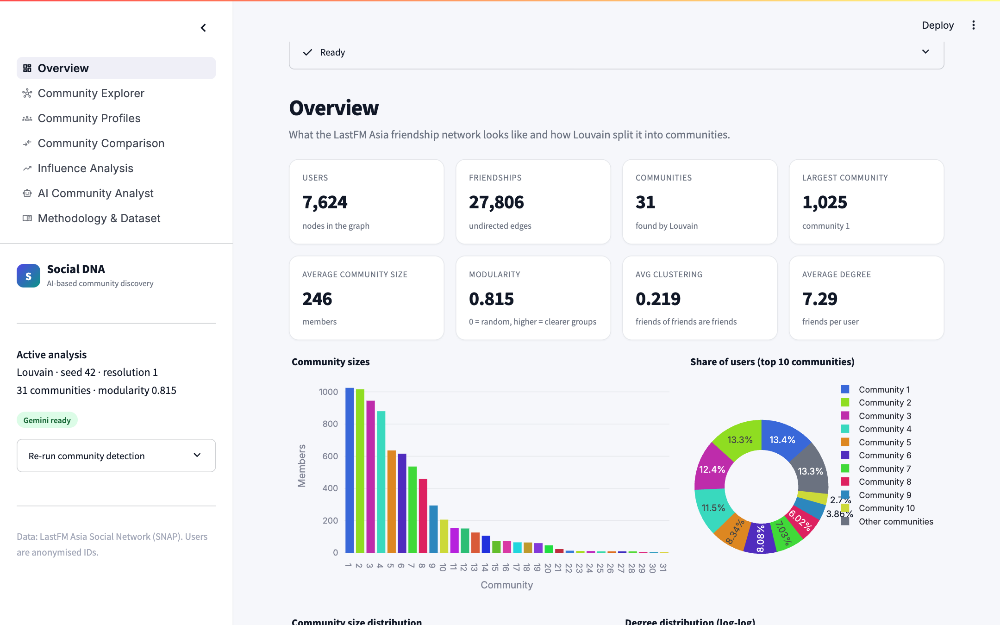
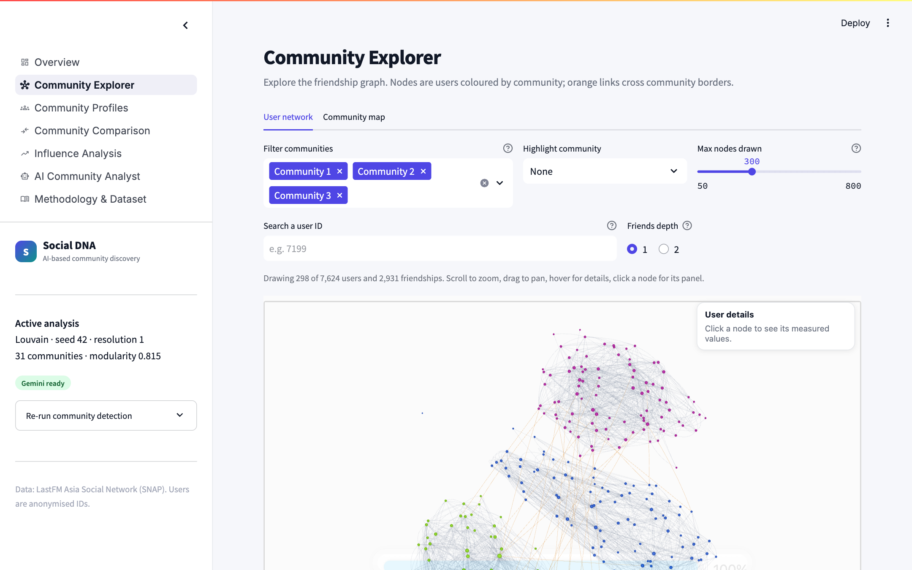
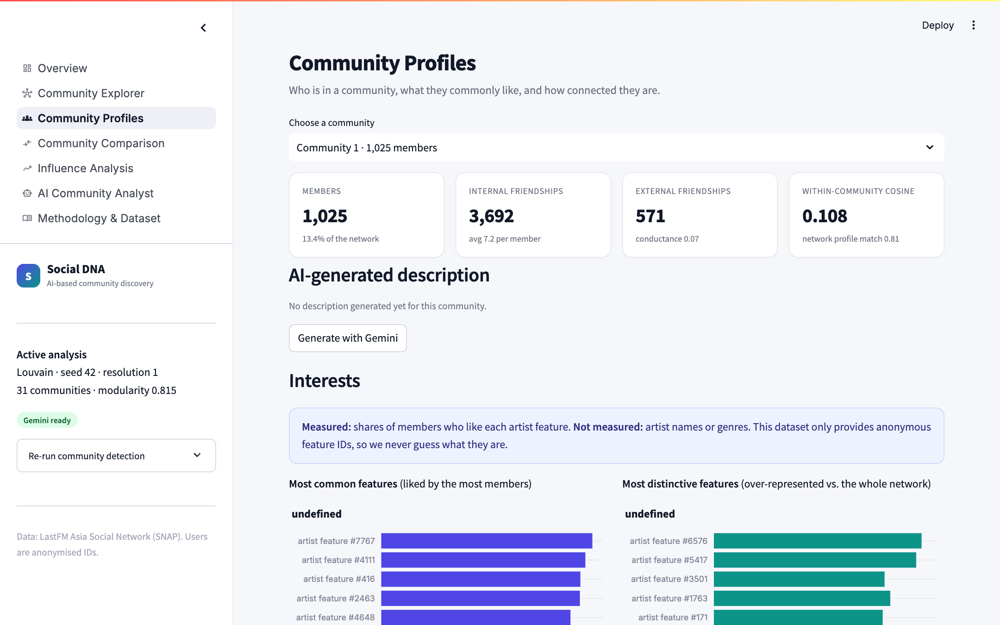
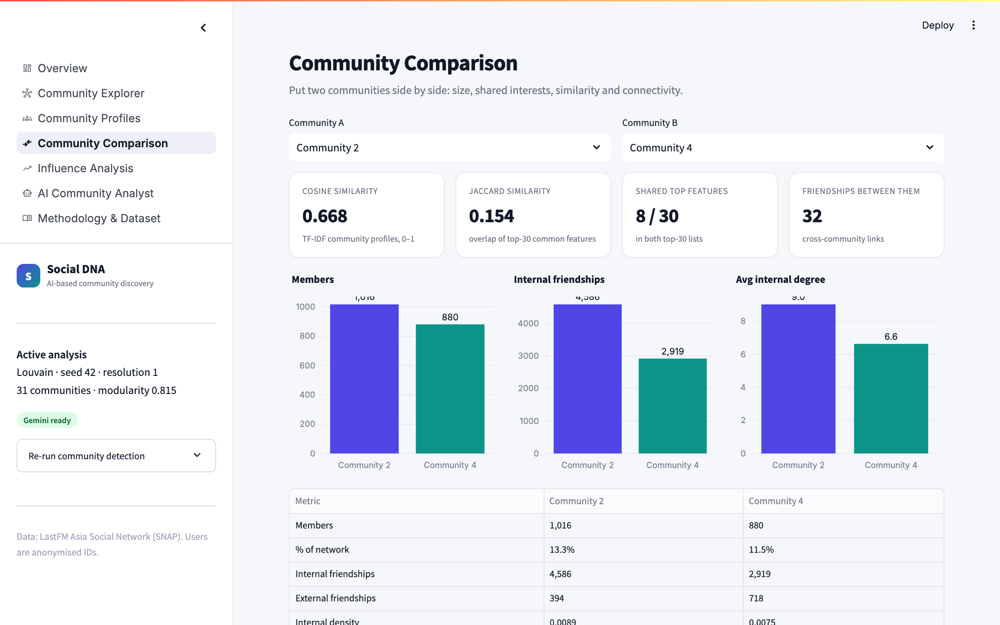
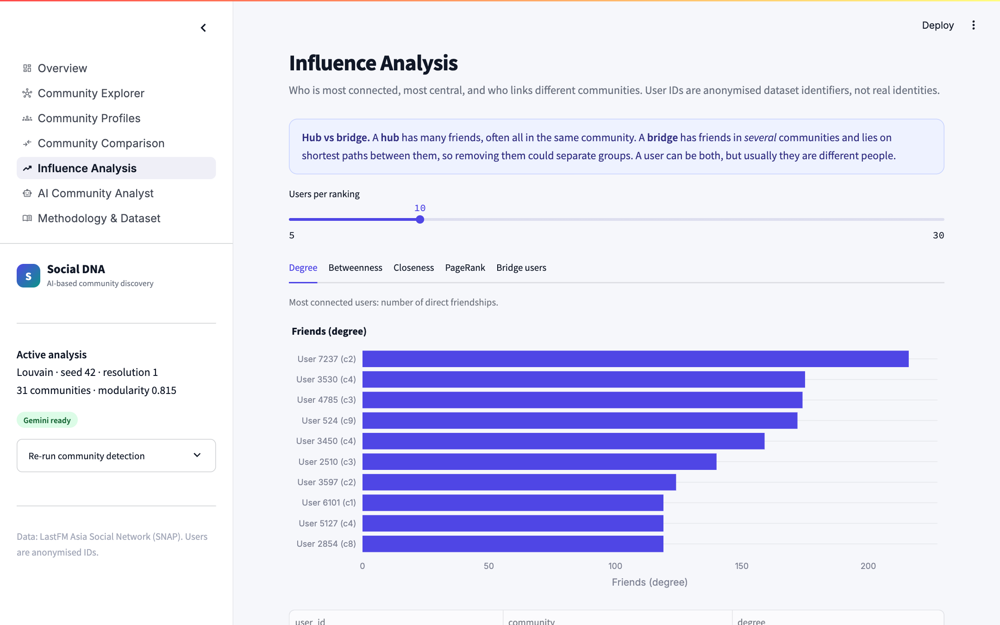
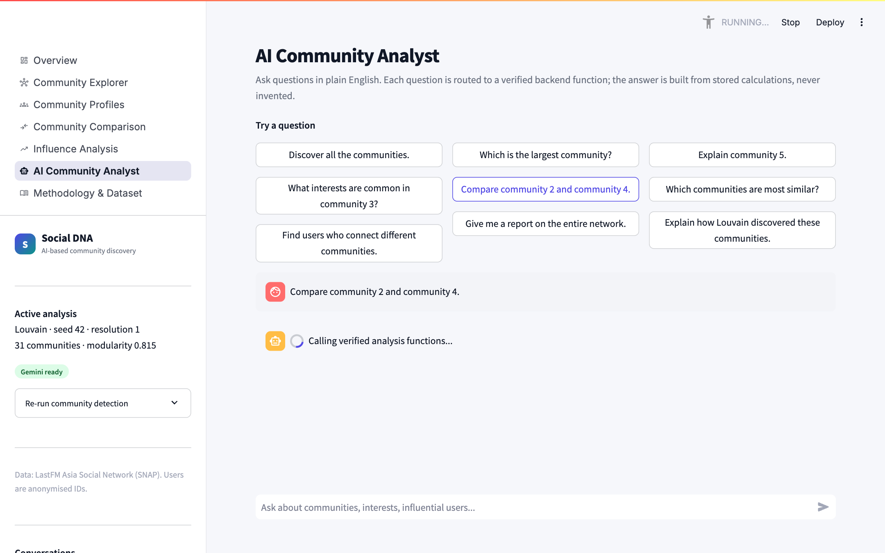

# Social DNA – AI-Based Community Discovery

Social DNA analyses a real social network, the **LastFM Asia** friendship graph (7,624 users, 27,806 friendships), to
discover communities, find what their members have in common, spot influential and "bridge" users, and explain the
results in plain English with **Google Gemini**. Everything shown is calculated from the dataset; the LLM only explains
verified numbers.

```
Dataset → Graph (NetworkX) → Louvain communities → Interest analysis → Gemini explanation → Streamlit dashboard
```

## Quick start on Windows (exact steps)

**You need:** Windows 10/11, **Python 3.10, 3.11 or 3.12 (64-bit)** and Git. Python 3.13 or newer has not been tested.

**Install once**

1. Install Python 3.12 from https://www.python.org/downloads/windows/ — on the first installer screen **tick "Add python.exe to PATH"**. Install Git from https://git-scm.com/download/win.
2. Open **Command Prompt** (press the Windows key, type `cmd`, press Enter) and run these lines one at a time:

```bat
git clone YOUR_REPOSITORY_URL
cd social-dna
python -m venv venv
venv\Scripts\activate
python -m pip install --upgrade pip
pip install -r requirements.txt
copy .env.example .env
notepad .env
```

3. Notepad opens. Replace `your_gemini_api_key_here` with your key from https://aistudio.google.com/apikey (no quotes, no spaces), save and close.
   *No key? Skip this: the dashboard still works; only the AI wording is replaced by plain verified summaries.*

**Run the website (first time and every time)**

```bat
cd social-dna
venv\Scripts\activate
python -m streamlit run app.py
```

Your browser opens at **http://localhost:8501**. If it does not, open that address yourself.
The **first launch takes 1–2 minutes** (it downloads the dataset and analyses it, with a progress display); later launches start in seconds.
Stop the website with **Ctrl+C** in the Command Prompt window.

**Open the presentation:** double-click `docs\Social_DNA_Presentation.html` (or run `start docs\Social_DNA_Presentation.html`). Arrow keys move between slides; **S** shows notes, **O** the overview, **F** fullscreen.

**Run the tests:** `python -m pytest -q`

**If something fails**

| Problem | Fix |
|---|---|
| `python is not recognized` | Re-run the Python installer, tick **Add to PATH**, then open a new Command Prompt. Or use `py -3.12` instead of `python`. |
| PowerShell: "running scripts is disabled" | Use **Command Prompt**, or run `Set-ExecutionPolicy -Scope Process Bypass` first |
| `venv\Scripts\activate` finds nothing | You are not inside the `social-dna` folder: run `cd social-dna` |
| Dataset download blocked (firewall / campus network) | Download `lastfm_asia.zip` from https://snap.stanford.edu/data/lastfm_asia.zip in a browser and put the zip in `data\raw\`, then run the website again |
| Port already in use | `python -m streamlit run app.py --server.port 8502` |
| "Gemini not configured" or "unavailable" | Check `.env` contains `GEMINI_API_KEY=your key`, then restart. Temporary Google overload (503/429) is handled automatically. |

macOS / Linux commands and more detail are further down.

## Features

- Automatic dataset download, validation (duplicates, self-loops, isolates, missing features, components) and caching
- Louvain community detection (seeded, re-runnable) and Greedy Modularity comparison, with stability and agreement metrics
- Common and distinctive interests per community (frequency, prevalence, lift), Jaccard and TF-IDF cosine similarity
- Degree, betweenness (sampled, labelled), closeness, PageRank, clustering, density; hub vs bridge users
- Persistent SQLite database with versioned migrations; results are reused on later launches
- 7-page dashboard: Overview, Community Explorer (interactive PyVis graph), Profiles, Comparison, Influence, AI Analyst chat, Methodology
- Natural-language analyst: Gemini function calling → validated backend functions → verified answer; works without Gemini (plain summaries)
- Automated test suite (`docs/test_report.md`) and a documented evaluation framework (`docs/evaluation.md`)

## Screenshots

Real screenshots of the running application (regenerate with `python scripts/capture_screenshots.py` while the app runs; needs `pip install -r requirements-dev.txt`):

| | |
|---|---|
|  |  |
|  |  |
|  |  |

## Presentation

`docs/Social_DNA_Presentation.html` is a single self-contained HTML presentation (dataset, method, results, model evaluation, demo
path). Open it in any modern browser: **arrow keys / space** to move, **drag or swipe** with momentum, **S** speaker notes, **O**
slide overview, **F** fullscreen. All numbers are filled in from the real database and evaluation results by
`python scripts/build_presentation.py` (re-run it after a new analysis or evaluation).

## Technology stack

Python 3.10–3.12 · Streamlit · SQLite · NetworkX · python-louvain · Pandas / NumPy / SciPy / scikit-learn · Plotly · PyVis · Google Gemini (`google-genai`) · Pytest

## Requirements

- **Python 3.10, 3.11 or 3.12** (64-bit). Developed on 3.12. Check with `python --version`.
- Git, about 300 MB disk space, internet access for the first launch (dataset download, about 3 MB) and for Gemini
- A free Gemini API key (optional but recommended): https://aistudio.google.com/apikey

## Setup – Windows (step by step)

1. Install Python 3.12 from https://www.python.org/downloads/windows/ and **tick "Add python.exe to PATH"** in the installer. Install Git from https://git-scm.com/download/win.
2. Open **Command Prompt** (or PowerShell) and run:

```bat
git clone YOUR_REPOSITORY_URL
cd social-dna
python -m venv venv
venv\Scripts\activate
python -m pip install --upgrade pip
pip install -r requirements.txt
copy .env.example .env
notepad .env
```

   In PowerShell, if activation says *"running scripts is disabled"*, run `Set-ExecutionPolicy -Scope Process Bypass` first, or use Command Prompt.
   If `python` is not found, use `py -3.12 -m venv venv` instead.

3. In Notepad, replace `your_gemini_api_key_here` with your key (no quotes, no spaces), save, close.
4. *(Optional, the app does this automatically on first launch)* prepare data and database:

```bat
python scripts\download_dataset.py
python scripts\validate_dataset.py
python scripts\initialise_database.py
python scripts\run_analysis.py
```

5. Start the app:

```bat
python -m streamlit run app.py
```

   The browser opens at http://localhost:8501. The first launch downloads the data and runs the analysis (about 1–2 minutes, with a progress display); later launches start in seconds.

## Setup – macOS / Linux

```bash
git clone YOUR_REPOSITORY_URL
cd social-dna
python3 -m venv venv
source venv/bin/activate
python -m pip install --upgrade pip
pip install -r requirements.txt
cp .env.example .env
nano .env            # set GEMINI_API_KEY=your key
python -m streamlit run app.py
```

(Optional explicit steps: `python scripts/download_dataset.py`, `validate_dataset.py`, `initialise_database.py`, `run_analysis.py`.)

## Environment configuration

`.env` (never committed; `.gitignore` excludes it):

| Variable | Meaning |
|---|---|
| `GEMINI_API_KEY` | Your Google Gemini API key. Without it the dashboard and analysis still work; AI explanations are replaced by plain summaries of the verified numbers. |
| `GEMINI_MODEL` | Optional. Default `gemini-3.5-flash-lite`. If a model is busy or retired the app automatically tries other current Gemini models. |
| `SOCIAL_DNA_SEED` | Optional default random seed for Louvain (default 42) |

If your key is not accepted, the sidebar and AI pages show how to fix it. Model names change over time; run `python -c "from google import genai; import os; c=genai.Client(api_key=os.environ['GEMINI_API_KEY']); print([m.name for m in c.models.list()])"` to see what your key can use.

## Dataset acquisition

Automatic on first launch: `data/raw/` is checked first; if files are missing they are downloaded from the official SNAP archive (UCI mirror as fallback), validated and cached in `data/processed/`. Nothing is downloaded again on later launches. If the download is blocked, download `lastfm_asia.zip` manually and put it in `data/raw/` (details in `data/README.md`).

## Testing

```bash
python -m pytest -q
```

Executed results are recorded in `docs/test_report.md`. Evaluation of the analysis and the AI analyst: `python scripts/run_evaluation.py` → `docs/evaluation.md`.

## Project structure

```
app.py                  navigation and entry point
pages/                  7 Streamlit pages
components/             theme, cards, charts, graph rendering, sidebar, chat helpers
core/                   config, dataset loader/validator, graph builder, pipeline orchestration
analysis/               louvain, greedy, metrics, interests, similarity, influence, evaluation, queries
llm/                    gemini client, prompts, context builder, query router, LLM evaluation
database/               connection, schema + migrations, repositories, initialisation
scripts/                download / validate / initialise / run_analysis / run_evaluation / test report / screenshots / HTML presentation
tests/                  pytest suite (synthetic graphs for unit tests only)
docs/                   architecture, algorithms, database, evaluation, limitations, test report, presentation (HTML), screenshots
data/                   raw/ and processed/ (git-ignored), evaluation/results.json
```

## Troubleshooting

| Problem | Fix |
|---|---|
| `python` / `pip` not found (Windows) | Re-install Python with "Add to PATH", or use `py -3.12 ...` |
| PowerShell blocks `activate` | `Set-ExecutionPolicy -Scope Process Bypass`, or use Command Prompt |
| `pip install` fails building a package | Use 64-bit Python 3.10–3.12 (newer versions may lack wheels); upgrade pip |
| Dataset download fails | Corporate/campus firewall: download `lastfm_asia.zip` manually into `data/raw/` |
| "Gemini not configured" | Create `.env` from `.env.example`, add the key, restart the app |
| Gemini "unavailable" / 429 / 503 | Temporary Google load or quota; the app retries, tries other models and keeps working with verified summaries |
| Port 8501 in use | `python -m streamlit run app.py --server.port 8502` |
| Start from scratch | Delete `data/processed/` (the database lives there) and relaunch |
| Page slow to draw the graph | Lower "Max nodes drawn" in Community Explorer |

## Limitations

See `docs/limitations.md`. Key points: artists are anonymous feature IDs (no names/genres); no ground-truth communities exist, so
conventional accuracy does not apply; betweenness is sampled; Gemini wording depends on an external service.

## Dataset attribution and licence

Data: *LastFM Asia Social Network*, Stanford SNAP / FEATHER project, B. Rozemberczki and R. Sarkar, *Characteristic Functions on
Graphs: Birds of a Feather, from Statistical Descriptors to Parametric Models*, CIKM 2020. Source: https://snap.stanford.edu/data/feather-lastfm-social.html.
The raw data is not redistributed in this repository. Source code: MIT licence (`LICENSE`); the dataset keeps its own terms.

## Publishing to GitHub

```bash
git init
git add .
git status          # check: no .env, no data/raw, no .sqlite files listed
git commit -m "Social DNA: AI-based community discovery"
git branch -M main
git remote add origin https://github.com/YOUR_USERNAME/social-dna.git
git push -u origin main
```
